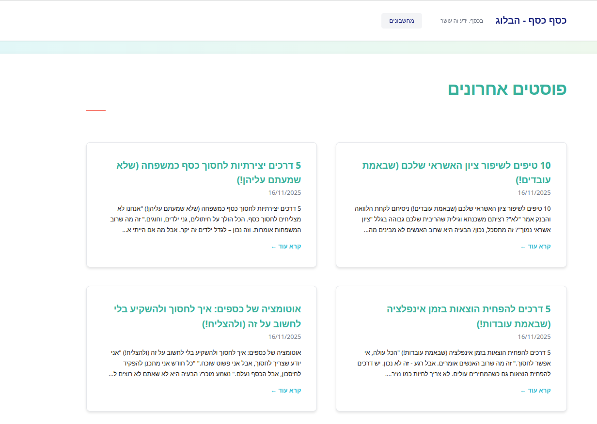
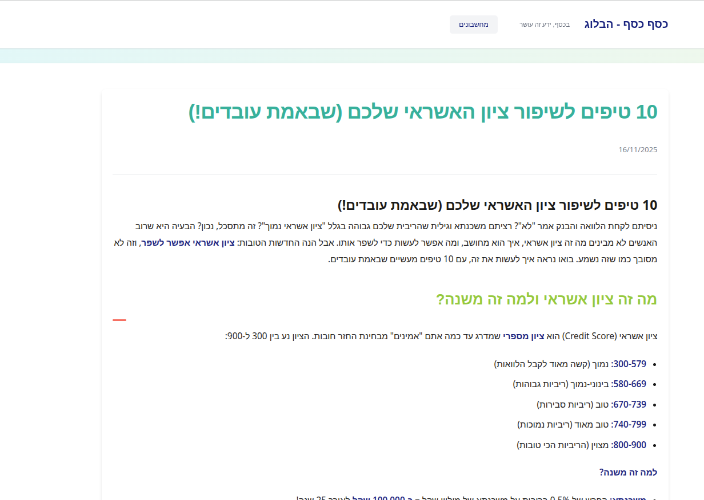
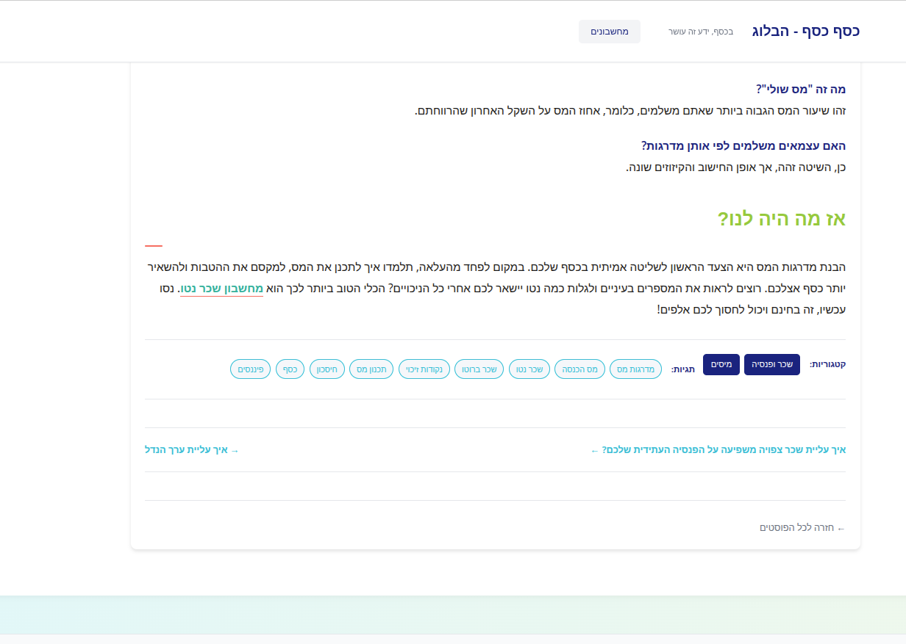

# RTL Blog Site Generator

A simple, fast, and elegant static blog generator built with Node.js. Designed specifically for RTL (Right-to-Left) languages like Hebrew and Arabic, but can be adapted for any language.

## Features

✨ **Simple & Fast** - Pure Node.js, no complex frameworks  
📝 **Markdown-based** - Write your posts in Markdown with front matter  
🏷️ **Categories & Tags** - Organize your content with categories and tags  
🌐 **RTL Support** - Built-in support for Hebrew and other RTL languages  
🎨 **Clean Design** - Modern, responsive design out of the box  
📦 **Static Output** - Generates pure HTML/CSS - deploy anywhere  
🚀 **Easy Deployment** - Deploy to Netlify, Cloudflare Pages, GitHub Pages, or any static host  

## Screenshots

### Homepage


### Blog Post


### Footer with Tags


## Quick Start

### Prerequisites

- Node.js 18.0.0 or higher
- npm (comes with Node.js)

### Installation

1. Clone this repository:
```bash
git clone <your-repo-url>
cd blog-app-for-github
```

2. Install dependencies:
```bash
npm install
```

3. Build and serve locally:
```bash
npm run dev
```

Your site will be available at `http://localhost:8000`

## Content Format

Create your blog posts as Markdown files in the `content/` directory. Each file should follow this format:

```markdown
---
title: "Your Post Title"
date: 2025-11-15
---

# Your Post Title

Your content goes here in Markdown format...

## Subheading

More content...

**Categories:** Category1, Category2, Category3
**Tags:** tag1, tag2, tag3, tag4
```

Or use Hebrew labels:

```markdown
**קטגוריות:** Category1, Category2, Category3
**תגיות:** tag1, tag2, tag3, tag4
```

### Front Matter Fields

- `title` (required): The title of your post
- `date` (required): Publication date in YYYY-MM-DD format

### Categories and Tags

At the end of your markdown file, add categories and tags. You can use either Hebrew or English labels:

**Hebrew:**
- **קטגוריות:** Category1, Category2, Category3
- **תגיות:** tag1, tag2, tag3

**English:**
- **Categories:** Category1, Category2, Category3
- **Tags:** tag1, tag2, tag3

**Note:** Both formats are supported! Use whichever you prefer, or modify the labels in `build.js` for other languages.

## Project Structure

```
.
├── content/           # Your markdown blog posts go here
├── templates/         # HTML templates
│   ├── layout.html   # Main layout wrapper
│   ├── index.html    # Homepage template
│   ├── post.html     # Individual post template
│   ├── category.html # Category page template
│   └── tag.html      # Tag page template
├── styles/           # CSS files
│   └── main.css     # Main stylesheet
├── images/           # Screenshots and documentation images
├── dist/            # Generated site (created on build)
├── build.js         # Build script
├── serve.js         # Development server
├── package.json     # Project dependencies
├── Dockerfile       # Multi-stage Docker build
├── .dockerignore    # Docker build exclusions
└── nginx.conf       # Nginx configuration for Docker
```

## Commands

```bash
# Build the site
npm run build

# Build and serve locally (development)
npm run dev

# Serve on a custom port
node serve.js --port 3000
```

## Customization

### Styling

Edit `styles/main.css` to customize the look and feel of your site.

### Templates

Modify the HTML templates in the `templates/` directory:
- `layout.html` - Main wrapper with header and footer
- `index.html` - Homepage layout
- `post.html` - Individual post layout
- `category.html` - Category archive page
- `tag.html` - Tag archive page

### Language & Direction

To change from RTL to LTR or modify language settings:
1. Edit `templates/layout.html` - change `dir="rtl"` to `dir="ltr"` and `lang="he"` to your language code
2. Edit `styles/main.css` - adjust text alignment and layout as needed
3. Edit `build.js` - update category/tag labels if needed

## Deployment

The generated site in the `dist/` directory is pure static HTML/CSS and can be deployed anywhere. Here are two **completely free** and easy options:

### 🚀 Option 1: GitHub Pages (100% Free)

GitHub Pages is perfect for hosting your blog directly from your GitHub repository.

#### Step-by-Step Guide:

1. **Push your code to GitHub** (if you haven't already):
   ```bash
   git init
   git add .
   git commit -m "Initial commit"
   git branch -M main
   git remote add origin https://github.com/yourusername/your-repo-name.git
   git push -u origin main
   ```

2. **Enable GitHub Actions** (Automatic Deployment):
   
   Create a file `.github/workflows/deploy.yml`:
   ```yaml
   name: Deploy to GitHub Pages

   on:
     push:
       branches:
         - main

   jobs:
     build-and-deploy:
       runs-on: ubuntu-latest
       
       permissions:
         contents: write
       
       steps:
         - name: Checkout
           uses: actions/checkout@v3
         
         - name: Setup Node.js
           uses: actions/setup-node@v3
           with:
             node-version: '18'
         
         - name: Install dependencies
           run: npm install
         
         - name: Build site
           run: npm run build
         
         - name: Deploy to GitHub Pages
           uses: peaceiris/actions-gh-pages@v3
           with:
             github_token: ${{ secrets.GITHUB_TOKEN }}
             publish_dir: ./dist
   ```

3. **Enable GitHub Pages in your repository**:
   - Go to your repository on GitHub
   - Click **Settings** → **Pages**
   - Under "Source", select **gh-pages** branch
   - Click **Save**

4. **Done!** Your site will be available at:
   ```
   https://yourusername.github.io/your-repo-name/
   ```

**Every time you push to the `main` branch, your site will automatically rebuild and deploy!** ✨

---

### ⚡ Option 2: Cloudflare Pages (100% Free + Super Fast)

Cloudflare Pages offers free hosting with a global CDN for lightning-fast load times.

#### Step-by-Step Guide:

1. **Push your code to GitHub** (if you haven't already) - see step 1 above

2. **Sign up for Cloudflare Pages**:
   - Go to [pages.cloudflare.com](https://pages.cloudflare.com)
   - Sign up for a free account (no credit card required)

3. **Create a new project**:
   - Click **"Create a project"**
   - Click **"Connect to Git"**
   - Authorize Cloudflare to access your GitHub account
   - Select your blog repository

4. **Configure build settings**:
   - **Project name**: Choose a name (this will be your subdomain)
   - **Production branch**: `main`
   - **Build command**: `npm run build`
   - **Build output directory**: `dist`
   - Click **"Save and Deploy"**

5. **Done!** Your site will be available at:
   ```
   https://your-project-name.pages.dev
   ```

**Benefits of Cloudflare Pages:**
- ⚡ Lightning-fast global CDN
- 🔒 Free SSL certificate
- 🌍 Unlimited bandwidth
- 🔄 Automatic deployments on every push
- 🎯 Custom domain support (free)

**Every time you push to GitHub, Cloudflare automatically rebuilds and deploys your site!** 🎉

---

### 📝 Quick Comparison

| Feature | GitHub Pages | Cloudflare Pages |
|---------|-------------|------------------|
| **Cost** | 100% Free | 100% Free |
| **Setup Time** | 5 minutes | 5 minutes |
| **Custom Domain** | ✅ Free | ✅ Free |
| **SSL Certificate** | ✅ Free | ✅ Free |
| **Build Time** | ~1-2 min | ~1 min |
| **CDN** | GitHub's CDN | Cloudflare's Global CDN |
| **Speed** | Fast | Super Fast |
| **Auto Deploy** | ✅ Yes | ✅ Yes |

**Both options are excellent!** Choose based on your preference:
- **GitHub Pages**: Great if you want everything in one place (code + hosting)
- **Cloudflare Pages**: Best if you want maximum speed and performance

---

### 🌐 Other Deployment Options

#### Netlify
1. Connect your GitHub repository to [Netlify](https://netlify.com)
2. Build command: `npm run build`
3. Publish directory: `dist`

#### Vercel
1. Connect your GitHub repository to [Vercel](https://vercel.com)
2. Build command: `npm run build`
3. Output directory: `dist`

#### Any Static Host
Simply upload the contents of the `dist/` directory to your web server via FTP/SFTP.

---

## 🐳 Docker Deployment

For those who prefer containerization, this project includes a multi-stage Dockerfile that builds your blog and serves it with nginx.

### What's Included

The Docker setup includes:
- **Multi-stage build**: Optimized image size by separating build and runtime
- **Nginx web server**: Fast, production-ready static file serving
- **Custom nginx config**: Optimized for RTL content with gzip compression, caching, and security headers
- **Small footprint**: Uses Alpine Linux for minimal image size (~25MB)

### Quick Start with Docker

#### Build the Docker image:
```bash
docker build -t my-blog .
```

#### Run the container:
```bash
docker run -d -p 8080:80 --name my-blog-container my-blog
```

Your blog will be available at `http://localhost:8080`

#### Stop the container:
```bash
docker stop my-blog-container
```

#### Remove the container:
```bash
docker rm my-blog-container
```

### Docker Compose (Optional)

Create a `docker-compose.yml` file:

```yaml
version: '3.8'

services:
  blog:
    build: .
    ports:
      - "8080:80"
    restart: unless-stopped
```

Then run:
```bash
docker-compose up -d
```

### Deploy to Production

You can deploy the Docker container to:

#### Docker Hub
```bash
# Tag your image
docker tag my-blog yourusername/my-blog:latest

# Push to Docker Hub
docker push yourusername/my-blog:latest
```

#### Cloud Platforms
- **AWS ECS/Fargate**: Deploy containers without managing servers
- **Google Cloud Run**: Serverless container deployment
- **Azure Container Instances**: Quick container deployment
- **DigitalOcean App Platform**: Simple container hosting
- **Fly.io**: Global container deployment

### Nginx Configuration

The included `nginx.conf` provides:
- ✅ **Gzip compression** - Faster page loads
- ✅ **Caching headers** - Optimized asset delivery
- ✅ **Security headers** - XSS protection, frame options
- ✅ **UTF-8 charset** - Proper RTL character rendering
- ✅ **Clean URLs** - Fallback to index.html for SPA-like behavior

You can customize `nginx.conf` to fit your specific needs.

### Benefits of Docker Deployment

- 🔒 **Isolated environment** - No conflicts with other applications
- 📦 **Portable** - Run anywhere Docker is supported
- 🚀 **Production-ready** - Nginx is battle-tested for static sites
- 🔄 **Easy updates** - Rebuild and redeploy in seconds
- 📊 **Scalable** - Easy to scale horizontally with orchestration tools

---

## Example Content

Check the `content/` directory for an example post that demonstrates the required format.

## License

MIT License - feel free to use this for any project!

## Contributing

Contributions are welcome! Feel free to open issues or submit pull requests.

## Support

If you encounter any issues or have questions, please open an issue on GitHub.
